# Compositing with an exported image sequence into After Effects

## Overview  

In this workshop we are going to composite your exported image sequence into After Effects and add some production effects.

We are aiming for something like this: 

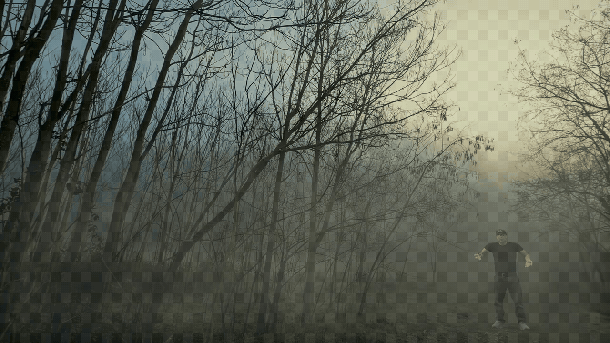
(see the full 20s video: https://youtu.be/g9yxjUjCvWk) 

To begin you'll need your exported sequence. Your image sequence (exported from Maya or Blender) should be .png images set with transparent background. The images should automatically output in a number sequence: 0001.png, 0002.png and so on.

You can use textures and skybox / backgrounds in your project (you do not need to create these).   
https://www.pexels.com/ is a good source of images.   

The exported sequence is imported into the composition, and is integrated into the scene using scaling, perspective and some filters / fog / post production effects.   

We are going to using Adobe After Effects 2025/26 to do the compositing. 

## 1. Importing into After Effects (AE)

Before you import any assets into After Effects create a dedicated folder for both your assets and your AE project file as I have done here. 

   

After Effects references files when they are in your project, so if you move the files the reference will be lost and your images will not show up in After Effects. 

This first video steps you through how to import your image sequence into After Effects and how set up your composition (timeline).  

[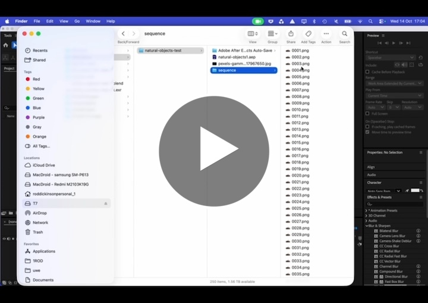](https://uwe.cloud.panopto.eu/Panopto/Pages/Viewer.aspx?id=3e2f1ab9-ff15-4a6d-ba96-b4e30108b647) 

## 2. Adding layers, effects and using the transform properties 

This video shows you how to add a new layer (a background in this case), how to add effects to layers (a blur in the case) and how to use the transform tools (scale in this case).

[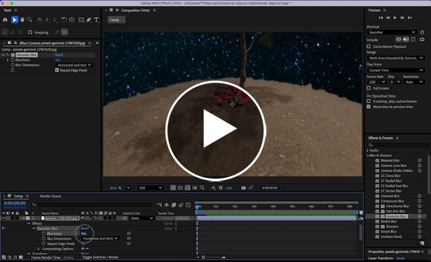](https://uwe.cloud.panopto.eu/Panopto/Pages/Viewer.aspx?id=caaa7422-0b1d-43b0-b5f7-b4e30109dda7) 

## 3. Add frames to a composition, How to freeze a frame, editing key frames and using transform properties

In this video you will learn how to:    
Alter the length of your timeline / composition.   
How to use the freeze frame tool.  
How to edit a keyframe.  
How to scale and animate an assets.  

[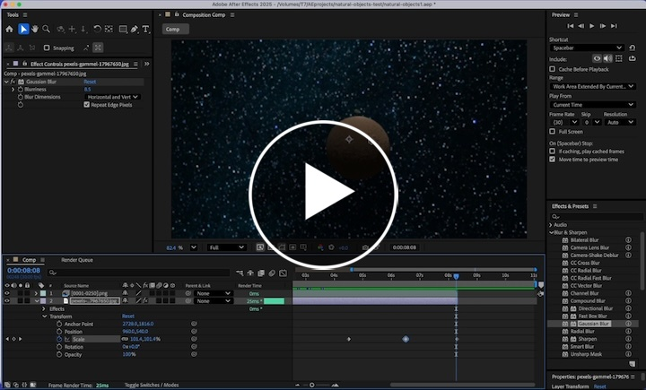](https://uwe.cloud.panopto.eu/Panopto/Pages/Viewer.aspx?id=3ac1b3cd-4caa-4240-bf86-b4e3010ee785) 

## 4. How to duplicate a layer and animate an assest with the transform (scale & position) properties

This video shows you how to duplicate a layer and edit it using key frames with the transfrom scale properties.  

[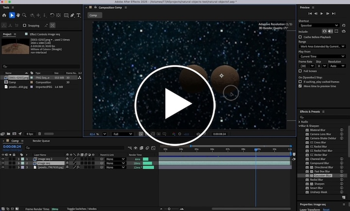](https://uwe.cloud.panopto.eu/Panopto/Pages/Viewer.aspx?id=5584eff3-651d-4f86-a4b2-b4e30112c65d) 

## 5. Adding some post production polish: Fog
This next video shows you how to add some animated atomsphere / fog to the scene.  

[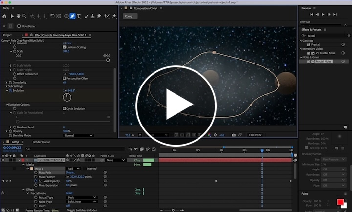](https://uwe.cloud.panopto.eu/Panopto/Pages/Viewer.aspx?id=7b3d220f-6d44-4b00-b489-b4e500f48567) 

## 6. Adding some post production polish: Colour filter / adjustment layer

This video shows you how to colour tint the whole scene with an adjustment layer.  

[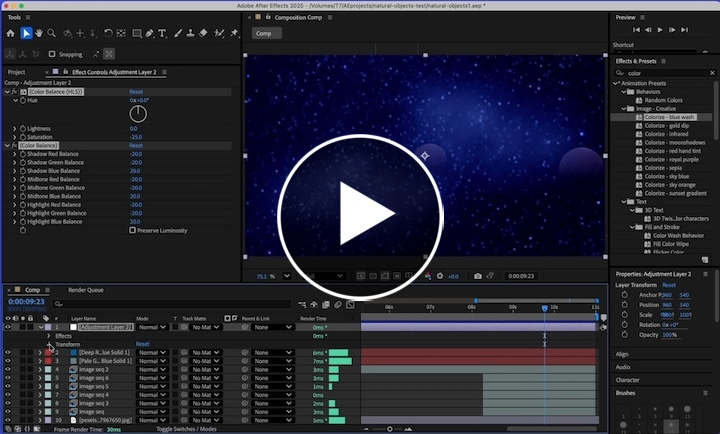](https://uwe.cloud.panopto.eu/Panopto/Pages/Viewer.aspx?id=f3f27da4-6943-483a-9aa7-b4e5010763c5) 

=======
## 7. Adding sounds to your composition
=======

## 8. Add to render queue and render output.

Once your video compositing is complete the final step is to render the output.  
Set the render area by dragging the handles (green laso). And then add to the render queue.  

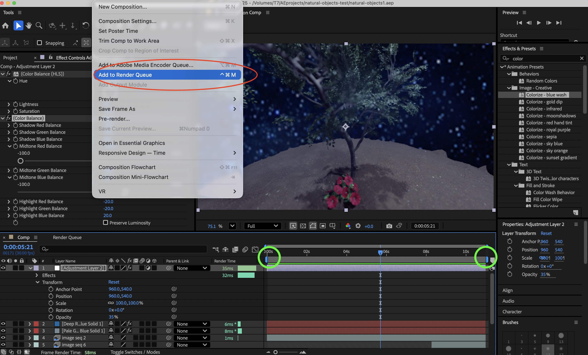

- View the render queue - yellow lasso
- In the render queue you can select where the output should go (and filename) - green lasso
- Leave the render settings as 'Best settings'
- And adjust the Output module. Click on Output module blue text to open the dialog / settings  - red lasso.

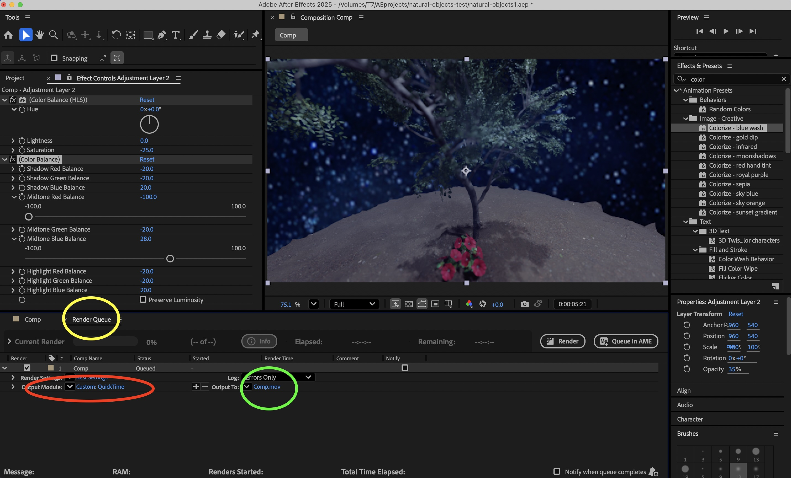

Adjusting the output module:  
- In the dialog / settings select quicktime. This will render the video as a .mov (on windows you should select .avi)

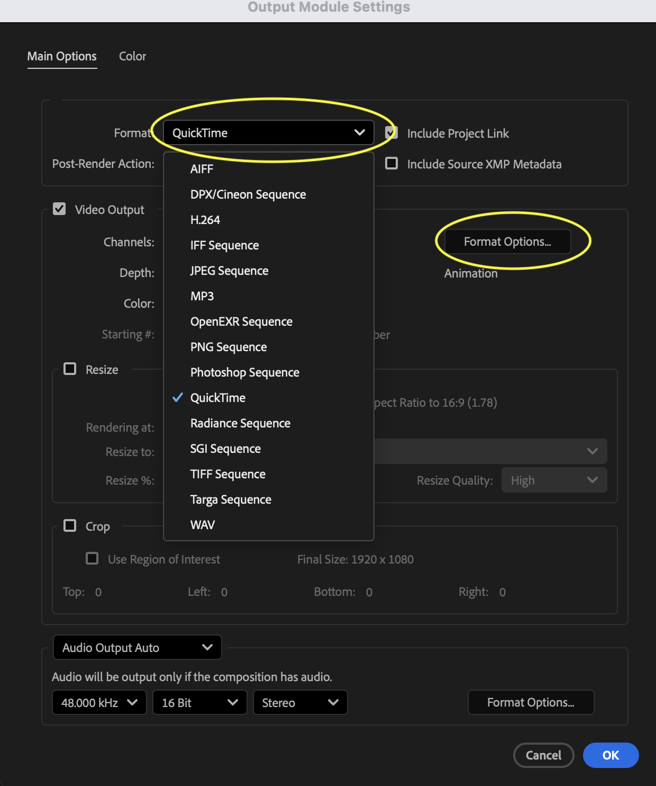

- Then click Format Options.  
- and select Apple ProRes 422 HQ
- Click Ok 

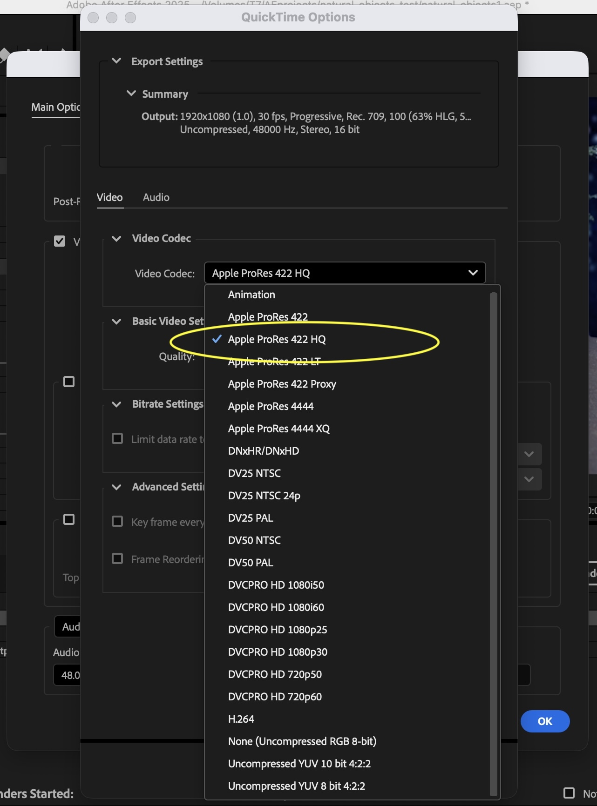

- Click Render to render the animation:

Your .mov or .avi will be a huge file. But it will be uncompressed and exactly what you want for the large 7m screen.  

If you are stuck you can watch this [video](https://uwe.cloud.panopto.eu/Panopto/Pages/Viewer.aspx?id=526ddc50-c1ed-4350-bb6e-b4e5010fab19) which steps you through the whole process

However for other purposes you can can compress it and change the format to .mp4 either using Adobe Media Encoder, or import it into Premiere or Cap cut to edit and add sound / graphics. (There isn't a video for this as we know you used Premiere extensively last year).  

Tip: Handbrake is an excellent free video converter and compressor   
https://handbrake.fr/downloads.php (I use it much more than Adobe Media Encoder).   

