# Greyboxing

In 3D production, often creating a simplified version of an environment before we start working with assets or producing is part of the workflow. This is called greyboxing. Using simple primitive objects: cubes, cylinder, planes to block out a scene.

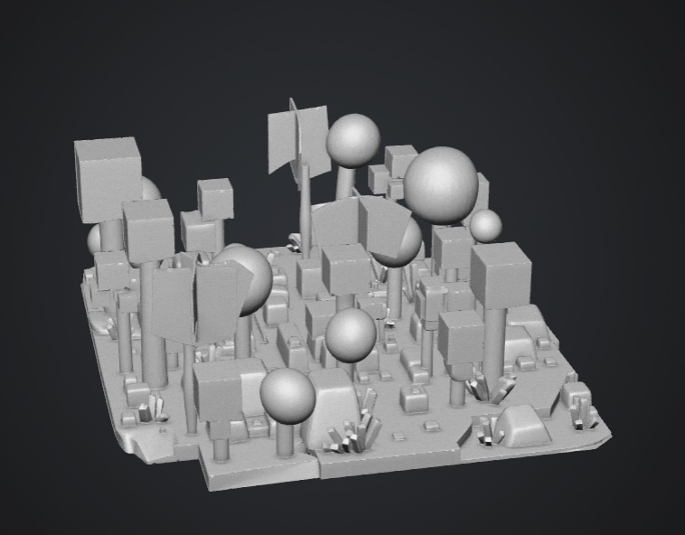

 

## 1. Set up

### Setup and create greybox scene

Set up the camera and 7m x 5m box. Build your scene in / behind the box.   
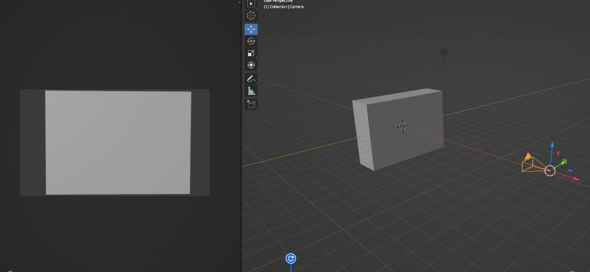

Build your scene in / behind the box.   
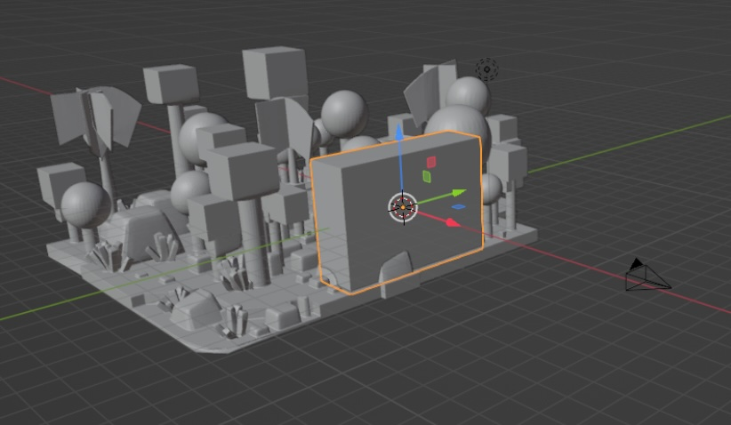  

The camera view should look like this. Tweak the camera position and rotation until it does.   
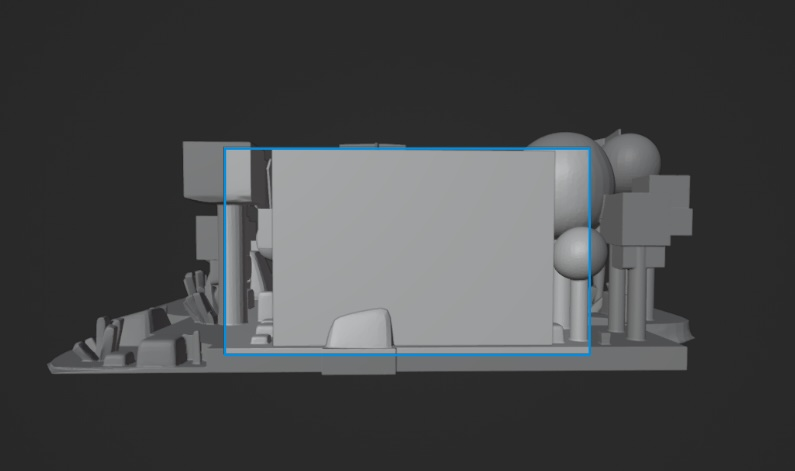  

Remove or hide the box.   
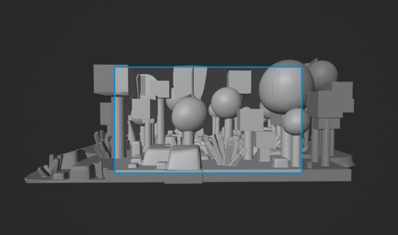 

## 2. Animation

Add some animation (objects moving / camera moving) that you are envisaging for your final scene.  

We will set the frame rate, the range and playback speed

[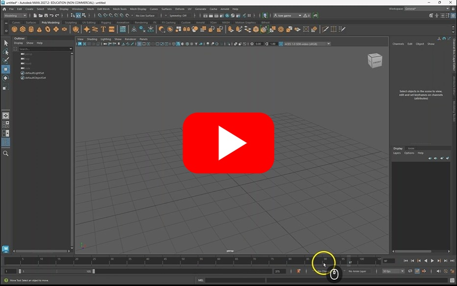](https://uwe.cloud.panopto.eu/Panopto/Pages/Viewer.aspx?id=9fc7857a-a966-4c2f-8d83-b49c00a34bd6)

### Keyframing

You can keyframe and animate most object properties.

[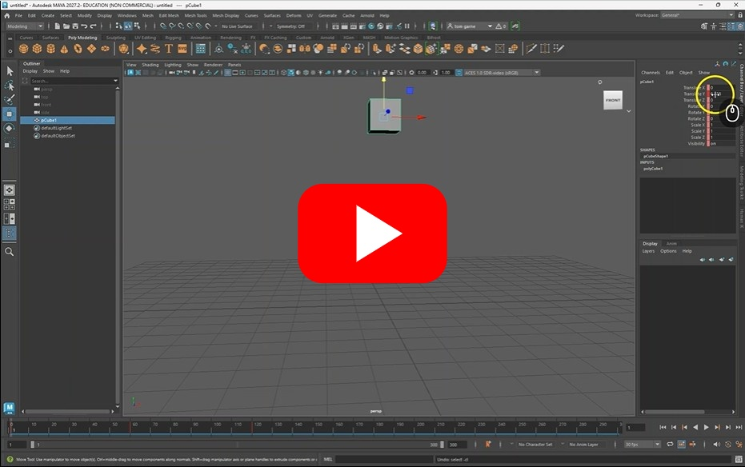](https://uwe.cloud.panopto.eu/Panopto/Pages/Viewer.aspx?id=0a187d9d-8bd7-4da5-a94e-b49c00a676a7)

You can find more how to animation techniques in the [animation worksheet](https://github.com/uwetom/media-production-worksheets/tree/master/week_05-Maya_animation_and_rigging)

## 3. Render / exporting

Render out the animation (as a PNG sequence).  

### Render settings

Now we have setup our camera we can render it out, but first we need to decide on the format and size of our rendered images.

[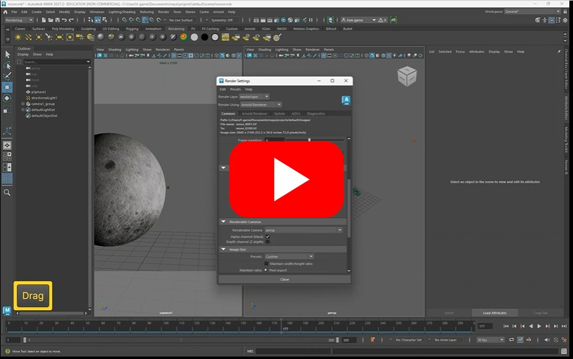](https://uwe.cloud.panopto.eu/Panopto/Pages/Viewer.aspx?id=7c7cb552-0fc0-49a1-9aa3-b49c00ef3d73)

#### Grey box settings

If you are rendering out a quick grey box version of your scene you can reduce the render quality settings.

Render to jpg and HD_1080

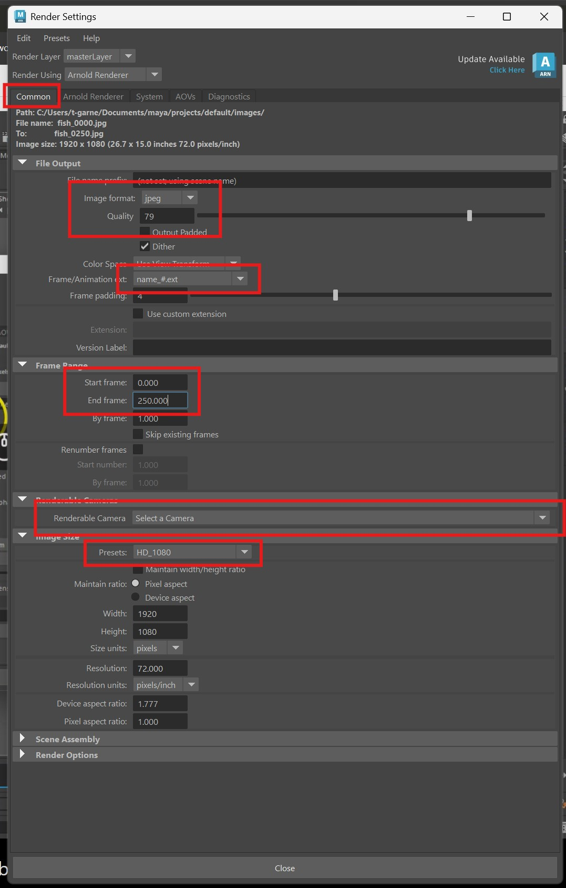

  

Reduce the Arnold render sampling.  

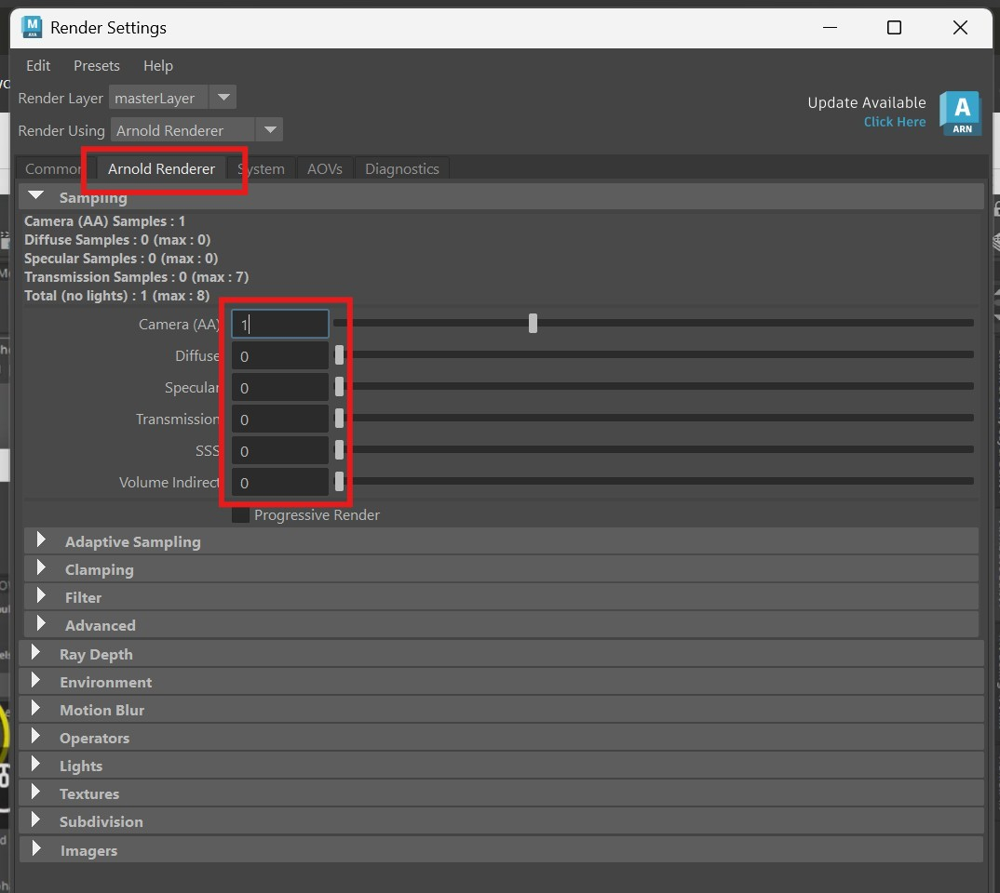

  

### Render a sequence

We can now render out our sequence.

[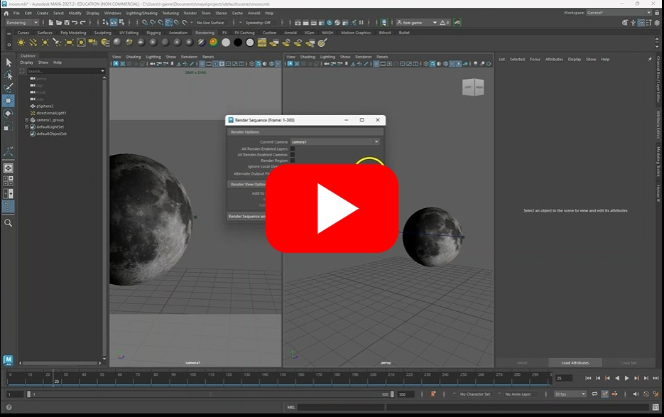](https://uwe.cloud.panopto.eu/Panopto/Pages/Viewer.aspx?id=1f0f82a9-14d8-447f-b3aa-b49c00f08e0d)

You should now have a folder full of rendered images.   

## 4. Import the image sequence to After Effects ready for exporting

You can import the folder full of rendered images into After Effects to the export them as a video file.
We are going to using Adobe After Effects 2025/26 to do the compositing. 

Before you import any assets into After Effects create a dedicated folder for both your assets and your AE project file as I have done here. 

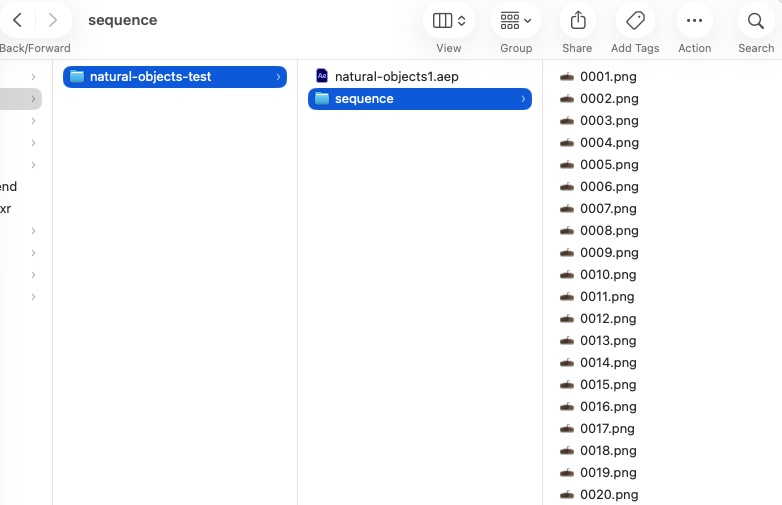

   

After Effects references files when they are in your project, so if you move the files the reference will be lost and your images will not show up in After Effects. 

This video steps you through how to import your image sequence into After Effects and how set up your composition (timeline).  

   

Once your still images are imported and added to a timeline (called a composition or comp in After Effects) check the comp settings (top menu: Composition > Composition settings. Set to preset 1920 x 1080.   

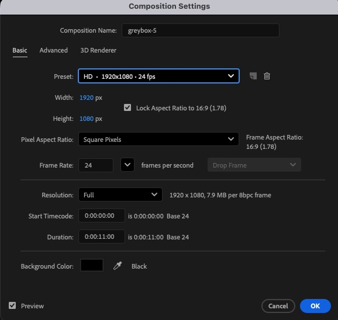

## 5. Add to render queue and render / export from After Effects

The final step is to render the output.  
Set the render area by dragging the handles (green laso). And then add to the render queue.  

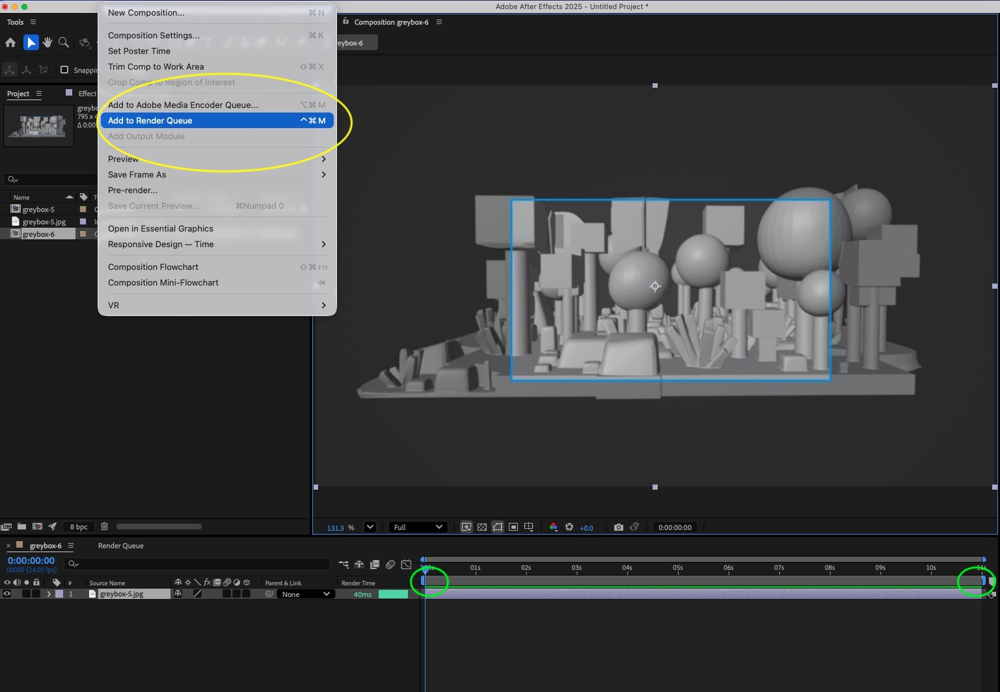

- View the render queue - yellow lasso
- In the render queue you can select where the output should go (and filename) - green lasso
- Leave the render settings as 'Best settings'
- And adjust the Output module. Click on Output module blue text to open the dialog / settings  - red lasso.

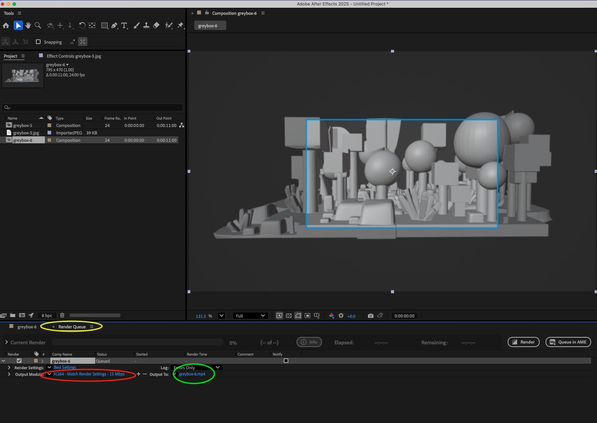

Adjusting the output module:  
- In the dialog / settings select H264. This will render the video as a .mp4    

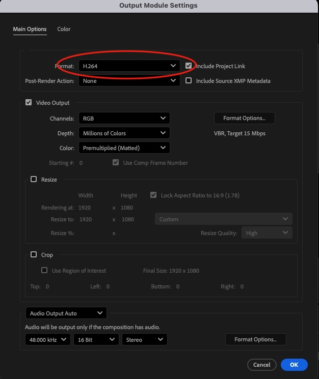

- Click Ok 

- Click Render to render the animation:

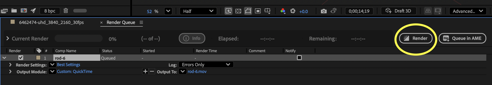

Your .mp4 file will be lower quality. But it will be adequate for testing on the large 7m screen.  

If you are stuck you can watch this [video](https://uwe.cloud.panopto.eu/Panopto/Pages/Viewer.aspx?id=526ddc50-c1ed-4350-bb6e-b4e5010fab19) which steps you through the whole process (this video suggests using the Quicktime settings, but instead use the settings above).

